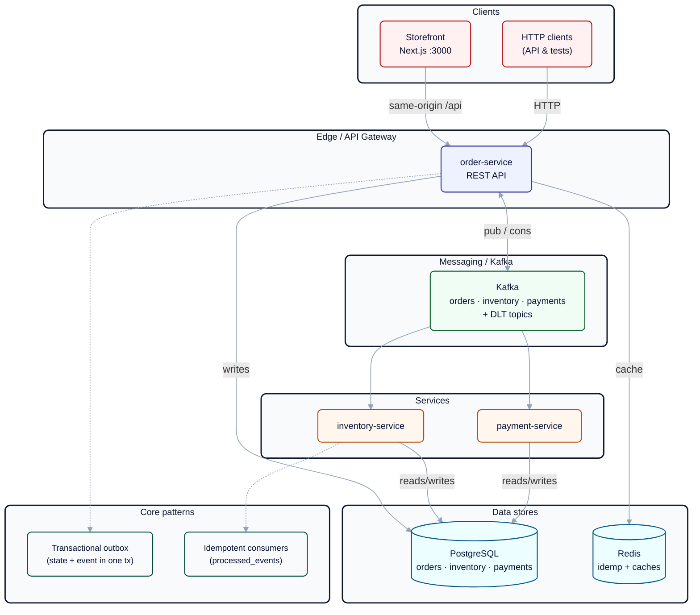

# Order Platform

Event-driven order platform for grocery-style orders: **order**, **inventory**, and **payment** services each own a database and coordinate through **Kafka** using a choreographed saga (no central orchestrator). A Next.js storefront in `web/` is the shop UI.

**Status:** Phases 1–4 implemented (happy path, failure/cancel/refund, edge API + SSE, storefront). The ops dashboard and observability are later phases.

## Architecture



**Core patterns:** transactional outbox (state + event in one DB transaction), idempotent consumers (`processed_events`), per-order Kafka keys, atomic stock updates, and compensation events (`inventory` compensation on failure).

| Happy path | `PENDING` → `RESERVED` → `CONFIRMED` |
| Failure | OOS → `CANCELLED`; payment decline → `CANCELLED` + stock released |
| Cancel | `POST /api/orders/{id}/cancel` → refund (if paid) + release stock |

## Stack

Java 21 · Spring Boot 3 · Maven · Kafka (KRaft) · PostgreSQL 16 · Redis 7 · Flyway · Testcontainers · Next.js · Tailwind

## Quick start

**Prerequisites:** Docker, JDK 21. Node.js is only needed to run the storefront outside Compose.

```bash
# Build and unit/integration tests
./mvnw verify

# Full stack (Kafka, Postgres, Redis, three services, storefront)
docker compose up --build

# Acceptance scenarios A1–A7 (Docker; forks JVM services)
./mvnw -pl acceptance-tests -Pacceptance test

# Storefront dev server (order-service on localhost:8080)
cd web && npm run dev
```

Shop UI: [http://localhost:3000](http://localhost:3000). `npm run dev` uses that same port, so stop the Compose `web` service before starting it. order-service stays on port 8080.

**Storefront (`web/`):**

- `/` product grid; stock refreshes every 5 seconds
- `/cart` in `localStorage` (`shop.cart`); money is integer cents
- `/checkout` posts `{ items, paymentToken }` with `Idempotency-Key`. The same key is reused until the cart or payment token changes, then dropped after a successful POST. Token `ok` succeeds. Token `fail` declines.
- `/orders` and `/orders/{id}` — the order page reads SSE from `/api/stream/orders/{id}` and refetches while the status is `PENDING` or `RESERVED`, so the timeline reaches `CONFIRMED` without a later event

The browser calls same-origin `/api`. REST (`/api/products`, `/api/orders`) is rewritten to `ORDER_SERVICE_URL` (Compose: `http://order-service:8080`, local default `http://localhost:8080`). `/api/stream/*` is a route handler so the event stream is not buffered.

**API (order-service, default port 8080):**

- `GET /api/products`
- `POST /api/orders` — create order (`Idempotency-Key` header required; payment token `ok` or `fail`)
- `GET /api/orders` and `GET /api/orders/{id}`
- `POST /api/orders/{id}/cancel`
- `GET /api/stream/orders/{id}` — SSE for one order

## Repository layout

| Path | Role |
|------|------|
| `common-events/` | Shared event envelope and payload types |
| `order-service/` | Public REST API, order state, outbox |
| `inventory-service/` | Stock and reservations |
| `payment-service/` | Simulated gateway, charges and refunds |
| `acceptance-tests/` | End-to-end scenarios (profile `acceptance`) |
| `web/` | Next.js storefront (shop, cart, checkout, live order page) |
| `docs/` | Requirements, architecture, phased build plan |
| `reference/node-prototype/` | Earlier Node reference (read-only) |

## Documentation

| Document | Contents |
|----------|----------|
| [docs/01-requirements.md](docs/01-requirements.md) | Functional requirements and acceptance criteria |
| [docs/02-architecture.md](docs/02-architecture.md) | Services, events, data model, invariants |
| [docs/03-phases.md](docs/03-phases.md) | Implementation phases and verify steps |
| [docs/mental-maps/](docs/mental-maps/) | What is implemented after each phase |
| [docs/Frontend-guidelines.md](docs/Frontend-guidelines.md) | Next.js storefront conventions (`web/`) |
